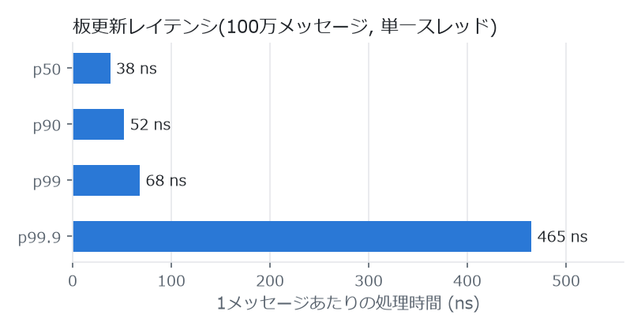

# hft-engine — C++ オーダーブックエンジン (Phase 1 + Phase 2)

板情報の高速管理・シグナル検出・性能計測を行うHFT学習/基盤プロジェクト。

<picture>
  <source media="(prefers-color-scheme: dark)" srcset="docs/latency-dark.png">
  
</picture>

```
=== HFT order book engine bench ===            (bench.exe 1000000)
throughput : 12.49 M msgs/sec
latency/msg: p50 38 ns | p90 52 ns | p99 68 ns | p99.9 465 ns
-- integrity check vs std::map reference --
PASS (11 checkpoints)
-- 2-thread (feed -> SPSC queue -> strategy) --
processed  : 1000030 msgs, 9.48 M msgs/sec end-to-end
```

- 計測環境: Windows 11 / MinGW-w64 g++ 15.2 / TSC 2.69 GHz。`-march=native` でビルドするため数値は CPU に依存します
- 高速化だけでなく、`std::map` による素朴な参照実装と最良気配を突き合わせて**正しさも毎回検証**しています
- GBDT(`build_ml.bat` → `backtest_ml.exe`、学習と別seedの合成フィード)では平均獲得 +0.690 ticks/signal と、
  往復コストの目安(spread/2 = 0.501)を上回りました。z-score ルールは +0.027 で下回ります。**いずれも合成フィード上の結果で、実市場の利益を示すものではありません**

## ビルドと実行

```bat
cd hft-engine
build.bat
bench.exe 1000000            :: リプレイベンチ + 整合性検証
bench.exe 1000000 --threaded :: SPSCキュー2スレッド構成も計測
backtest.exe 1000000 42      :: OFIシグナルのバックテスト → backtest_signals.csv
```

### Phase 2: 実データ(bitFlyer公開WS, 認証不要・無料)

```bat
live.exe                                  :: 端末1: TCP 9401で待受、受信→OFI→captures/に収録
python adapters\bitflyer_adapter.py       :: 端末2: bitFlyer WS → live.exe ブリッジ
replay.exe captures\capture_YYYYMMDD_HHMMSS.bin  :: 収録のリプレイ検証+採点 → replay_signals.csv
```

要件: MinGW-w64 g++ 13+(確認済み: 15.2.0)。外部依存なし。

## 構成

| ファイル | 内容 |
|---|---|
| `orderbook.hpp` | フラット配列L2板。価格=整数ティック→配列直引き、注文ID直引き、best増分維持 |
| `feed.hpp` | ITCH風バイナリメッセージ(A/X/E/D)+合成フィード生成器 |
| `signals.hpp` | OFI (Cont-Kukanov-Stoikov)、microprice、O(1)ローリングz-score |
| `spsc_queue.hpp` | ロックフリーSPSCリング(キャッシュライン分離、インデックスキャッシュ) |
| `bench.cpp` | rdtsc計測リプレイ + std::map参照実装との整合性検証 |
| `backtest.cpp` | OFIシグナル発火→前方mid変動で採点、CSV出力 |
| `live.cpp` | Phase 2: TCP受信→板更新→リアルタイムOFI表示、全フレームを`captures/`に収録 |
| `replay.cpp` | Phase 2: 収録リプレイ+参照実装検証、実時間ホライズンでシグナル採点 |
| `adapters/wire.py` | ワイヤ形式エンコーダ+拡張('R'リセット/アンカー, 'T'約定)。取引所非依存 |
| `adapters/bitflyer_adapter.py` | bitFlyer公開WS(板スナップショット/差分/約定)→合成注文A/X/D変換 |

## 実装しているHFTの定石

- **価格→配列インデックス直接変換**: `std::map`のポインタチェイスを排除。1レベル参照=1キャッシュライン
- **注文ID密連番の配列直引き**: ハッシュ表のプローブすら省く(実フィードでも参加者側で連番に再割当するのが定石)
- **best増分維持**: 消滅時のみtouch近傍を線形走査(分岐予測が効く)
- **rdtsc計測**: QPC(20-30ns/call)ではなく数nsのTSC読み。起動時にキャリブレーション
- **SPSCキュー**: mutex無し、acquire/release最小同期、false sharing回避、busy spin(sleepしない)
- **ホットパスで割当ゼロ**: リプレイループ中にヒープ確保なし

## 合成フィードの構造

潜在ドリフト状態(マルコフ切替、平均500イベント)が「発注サイドの偏り」と
「フェアバリューの移動」の両方を駆動する。オーダーフローが将来のmid変動を
弱く先行する構造のため、OFIシグナルの検出力をバックテストで確認できる。
実データではないので、バックテスト結果は「エンジンとシグナル計算が正しく動く」
ことの確認であり、実市場のエッジの証明ではない。

## Phase 2(実装済み: bitFlyer公開WS)

kabuステーションAPIは口座+API申請が必要なため、まず認証不要のbitFlyer公開
WebSocket(BTC_JPY板)で実データ接続を実装した。構成:

- アダプタ(Python)がWSのレベル差分を合成注文(A/X/D)に変換し、Phase 1と同じ
  バイナリワイヤ形式+タイムスタンプでlocalhost TCPへ流す。約定は'T'で記録専用
- 価格窓は初回スナップショットのmid中心にアンカー('R'メッセージ)。bestが窓端
  4096ティック以内に迫ると再アンカー(板リセット+再送)。live/replayは
  `-DHFT_PX_WINDOW=1048576`でビルド(±約52万円をカバー)
- 数量単位は1e-6 BTC、価格ティックは1 JPY
- live.exeが全フレームをそのまま収録 → replay.exeで参照実装との整合性検証と
  OFIシグナルの実時間採点(既定: 5秒先のmid変動)ができる。収録データは
  今後のGBDT学習(板特徴量→短期mid予測)の学習データになる

kabuステーション移行時は`adapters/`に同形式のアダプタを足すだけでC++側は無変更。
個人の現実的な遅延はms級(インターネット経由)であり、それがこの構成の到達点。

### 銘柄スクリーナ: どの銘柄に接続すべきかの提示

```bat
python adapters\scan_products.py                :: 全公開商品を10分観測してランキング
python adapters\scan_products.py --minutes 3    :: 観測時間の変更
python adapters\scan_products.py --selftest     :: ネット不要の指標計算の自己検証
```

bitFlyerの全公開商品(現物 *_JPY + FX_BTC_JPY)を1本のWSで同時観測し、
「予測しやすさ×収益性」でランク付けして `--product` に渡すべき銘柄を提示する。
結果は表示に加えて `scan_products.csv` にも出力。

- **予測しやすさ**: エンジンと同じbest-level OFI(過去`--window`秒合計)と
  `--horizon`秒先midリターンのSpearman相関(ic)と、|OFI|上位1/4での方向的中率(hit)
- **収益性**: `edge_bps = (2*hit-1)*vol_bps - spread_bps - 2*fee_bps`
  (シグナル発火時にテイカー往復した場合の1トレードあたり推定エッジ)
- 短時間観測のスナップショットなので結果は時間帯依存。恒常的エッジの証明ではなく
  「今どの板が最もシグナルが乗りやすいか」の目安
## Phase 3 以降(参考)

- **kabuステーションAPI**: 口座取得後に`adapters/kabu_adapter.py`を追加して株へ移行
- カーネルバイパス(DPDK)はLinux実機+対応NIC、FPGAは
  ボード+HDL開発が必要。個人環境ではVerilatorシミュレーション等の学習に留まる。
  真のHFT(μs級)には取引所コロケーション・取引参加者資格・専用フィード契約が必要

## ライセンス

[MIT License](LICENSE) © 2026 purplecatman2005-dev
